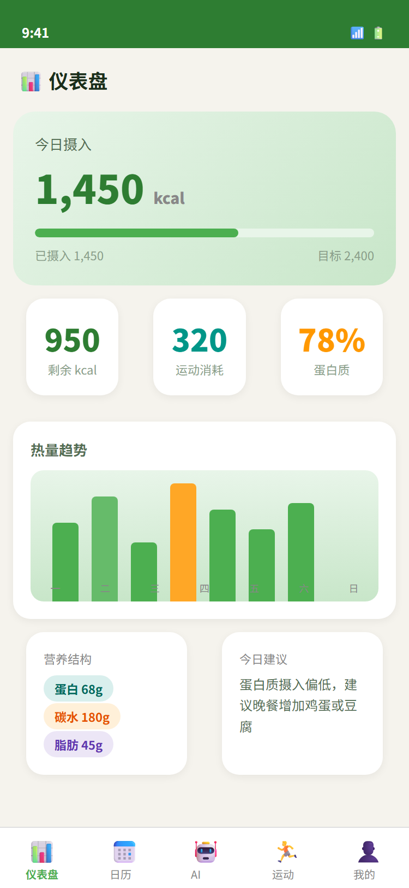
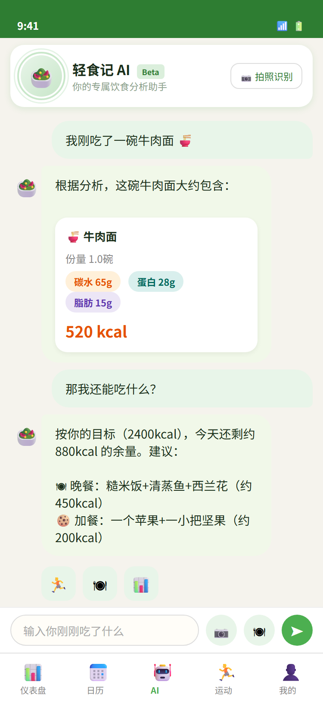
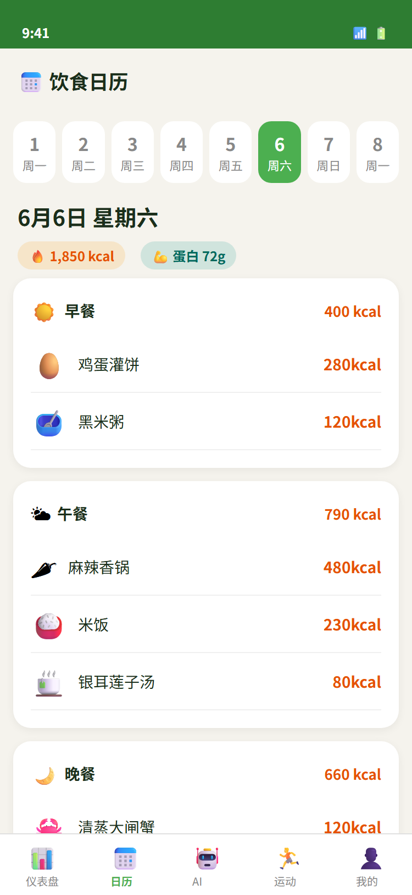
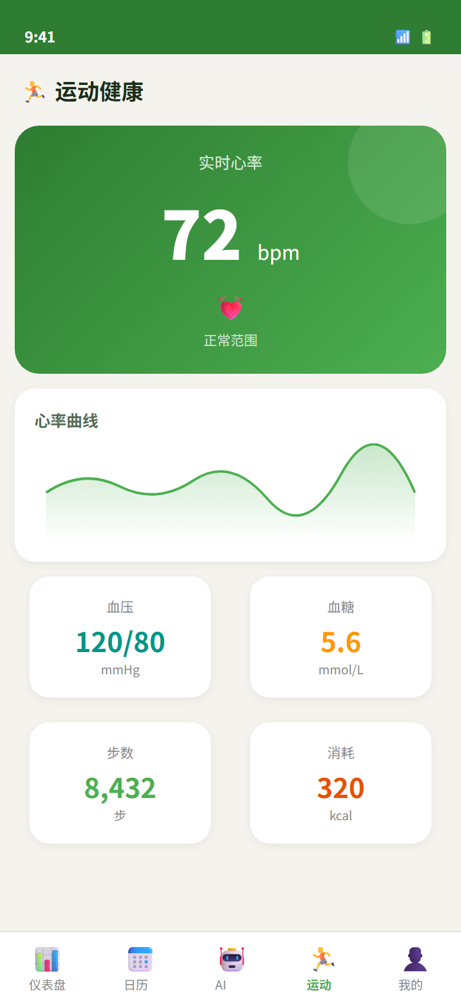

# DietApp — 健康饮食 Android 应用

面向日常饮食管理的安卓客户端：记录三餐与营养素、AI 对话建议、菜品拍照识别、运动与体脂趋势。

## 界面预览

| 仪表盘 | AI 对话 |
|---|---|
|  |  |

| 饮食日历 | 运动健康 |
|---|---|
|  |  |

> 截图由 `docs/design/mockups.html` 渲染而来（该文件是界面原型，可直接用浏览器打开）。

## 功能

- **饮食记录**：按早/午/晚/加餐录入食物，本地食物知识库估算热量与三大营养素
- **AI 对话**：接入 DeepSeek，结合饮食上下文给出营养建议
- **拍照识菜**：后端调用百度菜品识别，回填候选菜品
- **健康面板**：热量目标进度、营养素分布、体脂/运动趋势
- **日历回看**：按日期查看历史饮食

## 技术栈

| 层级 | 技术 |
|------|------|
| 客户端 | Kotlin · Jetpack Compose · Material 3 · Navigation · Retrofit |
| 后端（配套） | Node.js · Express · MySQL · JWT |
| AI / 识别 | DeepSeek Chat · 百度智能云菜品识别 |

## 项目结构

```
DietApp/
├── app/src/main/java/com/dietapp/
│   ├── ui/          # dashboard / chat / calendar / exercise / profile
│   ├── data/        # repository · api · 本地知识库 · 用户偏好
│   └── MainActivity.kt
├── app/src/main/res/
├── docs/
│   ├── screenshots/ # README 用的界面截图
│   └── design/      # 界面原型（mockups.html 及图标探索稿），可用浏览器直接打开
└── build.gradle.kts
```

配套后端仓库见本地 `diet-app-server`（Express + MySQL），通过 `BuildConfig.API_BASE_URL` 对接。

## 构建

1. 用 Android Studio 打开本目录
2. 配置 `local.properties` 中的 `sdk.dir`
3. 将 `API_BASE_URL` 指向后端服务后运行 `app`

## AI 协作说明

本项目在编码阶段使用 AI 工具协作完成界面骨架、Repository/API 层与食物知识库整理；运行时 AI 能力由 DeepSeek 与百度识别接口提供。

## License

仅供学习与作品展示。
